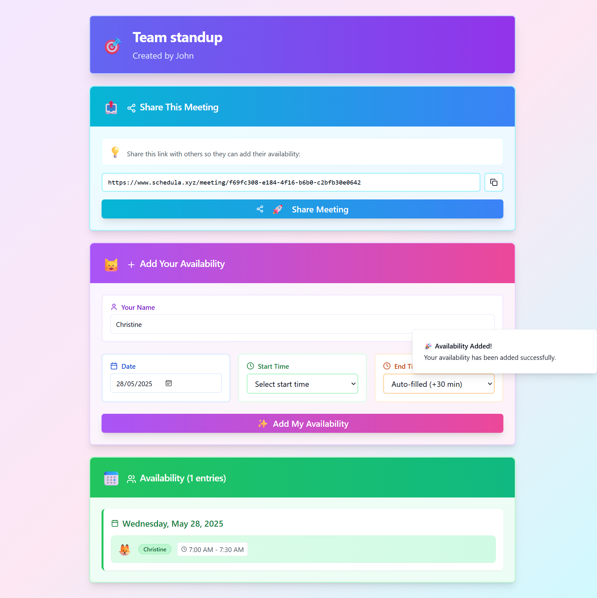

# Schedula: Effortless Meeting Coordination

**Transform chaotic scheduling into seamless coordination**

Schedula is a modern web application designed to streamline the process of finding optimal meeting times for teams and organizations. Eliminate back-and-forth email exchanges and scheduling conflicts with our intuitive, visual approach to availability management.



## ✨ Key Features

### 🎯 **Smart Meeting Management**

- **Instant Setup**: Create meetings in seconds with just a title and organizer name
- **Editable Details**: Update meeting information with inline editing
- **Unique Shareable URLs**: Each meeting generates a secure, shareable link
- **No Account Required**: Participants can join without creating accounts

### 📅 **Intelligent Availability Collection**

- **Visual Time Selection**: Intuitive interface for marking available time slots
- **Smart Suggestions**: Automatic end-time calculation (default +30 minutes)
- **Persistent User Data**: Remembers participant names using local storage
- **Flexible Scheduling**: Support for any date and time combination

### 📊 **Advanced Visualization**

- **Consolidated View**: Clear visual representation of all participant availability
- **Overlap Detection**: Automatically identifies common available time slots
- **Participant Tracking**: Visibility of submitted availability
- **Mobile-Optimized**: Responsive design that works across all devices

## 🚀 Technology Stack

### **Frontend**

- **[React 18](https://reactjs.org/)** - Modern component-based architecture
- **[TypeScript](https://www.typescriptlang.org/)** - Type-safe development
- **[Vite](https://vitejs.dev/)** - Lightning-fast build tool and dev server
- **[Tailwind CSS](https://tailwindcss.com/)** - Utility-first styling framework
- **[shadcn/ui](https://ui.shadcn.com/)** - Professional component library
- **[React Router](https://reactrouter.com/)** - Client-side routing

### **Backend & Infrastructure**

- **[Supabase](https://supabase.com/)** - PostgreSQL database
- **[Vercel Functions](https://vercel.com/docs/functions)** - API deployment platform

### **Development Tools**

- **[ESLint](https://eslint.org/)** - Code linting and formatting
- **[Playwright](https://playwright.dev/)** - End-to-end testing
- **Package Managers**: Bun (preferred) or npm

## 🛠️ Local Development Setup

### **Prerequisites**

- [Node.js](https://nodejs.org/) (LTS version recommended)
- npm (bundled with Node.js)
- [Git](https://git-scm.com/)
- Supabase account for database

### **1. Clone the Repository**

```bash
git clone <YOUR_GIT_URL>
cd schedula
```

### **2. Install Dependencies**

```bash
npm install
```

### **3. Environment Setup**

Create a `.env` file in the root directory:

```bash
cp env.example .env
```

Add your environment variables:

```env
# Supabase Configuration
SUPABASE_URL=your_supabase_project_url
SUPABASE_ANON_KEY=your_supabase_anon_key
```

### **4. Database Setup**

#### **Supabase Configuration**

1. Create a new project at [Supabase](https://supabase.com/)
2. Navigate to the SQL Editor in your dashboard
3. Run [`supabase-schema.sql`](./supabase-schema.sql) in the Supabase SQL Editor. It creates the `schedula` schema, the `meetings` and `availability` tables, and the public-access RLS policies used by the API functions.

### **5. Start Development Server**

```bash
npm run dev:full
```

The full application, including `/api/*`, will be available at `http://localhost:3000`.

## 📦 Available Scripts

```bash
# Development
npm run dev:full     # Validate .env and start Vercel + Vite on port 3000
npm run dev          # Start Vite only (no API functions)
npm run typecheck    # Check browser, API, and tooling TypeScript
npm run build        # Typecheck, then build for production
npm run build:dev    # Typecheck, then build in development mode
npm run preview      # Preview the production bundle
npm run lint         # Run ESLint

# Testing
npm run test:unit    # Run deterministic domain and API contract tests
npm run dev:api      # Start the API handlers on :3001 (needs a local `supabase start`)
npm test             # Run Playwright tests (starts API + Vite; local Supabase only)
```

## 🚀 Deployment

### **Vercel Deployment (Recommended)**

1. **Connect Repository**

   - Sign up at [Vercel](https://vercel.com/)
   - Import your Git repository

2. **Configure Build Settings**

   - Build Command: `npm run build`
   - Output Directory: `dist`
   - Install Command: `npm install`

3. **Environment Variables**

   - Add all environment variables from your `.env` file
   - Ensure `SUPABASE_URL` and `SUPABASE_ANON_KEY` are set. The API functions use them to access the `schedula` schema.

4. **Deploy**
   - Vercel will automatically deploy on every push to your main branch

### **Custom Deployment**

The built files will be in the `dist/` directory after running `npm run build`. Deploy these static files to any hosting provider.

## 🎯 Use Cases

- **Corporate Teams**: Standup meetings, client calls, interviews
- **Educational Institutions**: Faculty meetings, student group projects
- **Consulting Firms**: Client scheduling and team coordination
- **Personal Projects**: Social gatherings and networking events

## 🔧 Project Structure

```
schedula/
├── src/
│   ├── components/          # React components
│   │   ├── ui/             # shadcn/ui components
│   │   ├── AddAvailability.tsx
│   │   ├── AvailabilityDisplay.tsx
│   │   ├── CreateMeeting.tsx
│   │   ├── MeetingView.tsx
│   │   └── ShareMeeting.tsx
│   ├── hooks/              # Custom React hooks
│   ├── integrations/       # API client and shared data types
│   ├── lib/                # Utility functions
│   ├── pages/              # Page components
│   └── main.tsx            # Application entry point
├── public/                 # Static assets
├── api/                    # Vercel API functions
├── supabase/               # Versioned database migrations
├── supabase-schema.sql     # Fresh database schema and RLS setup
├── tests/                  # Deterministic unit tests
└── e2e/                    # Playwright tests
```

## 🤝 Contributing

We welcome contributions! Please feel free to:

1. Fork the repository
2. Create a feature branch (`git checkout -b feature/amazing-feature`)
3. Commit your changes (`git commit -m 'Add amazing feature'`)
4. Push to the branch (`git push origin feature/amazing-feature`)
5. Open a Pull Request

### **Development Guidelines**

- Follow TypeScript best practices
- Use conventional commit messages
- Ensure all tests pass before submitting
- Update documentation for new features

## 📋 Roadmap

### **Phase 1** ✅

- Core scheduling functionality
- Responsive web interface
- Basic availability visualization

### **Phase 2** 🔄

- Calendar integration (Google, Outlook, Apple)
- Advanced time zone management
- Email notifications and reminders

### **Phase 3** 📅

- Recurring meeting support
- Team scheduling templates
- Analytics and reporting dashboard

### **Phase 4** 📅

- Mobile applications (iOS/Android)
- API for third-party integrations
- Enterprise features (SSO, user management)

## 🔒 Security & Privacy

- **Data Encryption**: All data transmitted and stored with enterprise-grade encryption
- **Privacy First**: Minimal data collection with transparent policies
- **GDPR Compliant**: Full compliance with international data protection regulations
- **Secure Infrastructure**: Deployed on enterprise-grade cloud platforms

## 📄 License

This project is licensed under the MIT License - see the [LICENSE](LICENSE) file for details.

## 🆘 Support

If you encounter any issues or have questions:

1. Check the [documentation](./docs/)
2. Search existing [issues](../../issues)
3. Create a new issue with detailed information

## Analytics

This project now includes Google Analytics via the Google Tag (G-Z7WBMVTNYJ). The tracking snippet is injected in `index.html` so visits are measured automatically when deployed to Vercel.

---

**Ready to transform your meeting coordination?** 🚀 [Get started with Schedula today!](#-local-development-setup)
